# Underrail Save Editor

**Respec a build that went wrong, try out a feat before you commit to it, top up your crafting components,
or unstick a quest – without starting a new run.**

A save editor for [Underrail](https://www.stygiansoftware.com/underrail/) and its expansions, with a full
graphical interface. Every item, feat, icon and description comes straight from your own game
installation, so what you see looks and reads like the game itself.

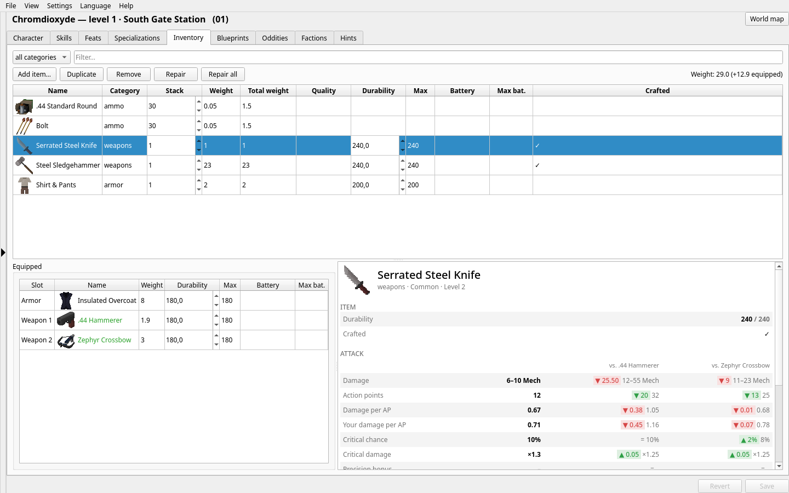

> Unofficial fan project – not made, endorsed or supported by Stygian Software and not affiliated with
> them. Underrail and its assets belong to Stygian Software.

## Highlights

- 🧬 **Rebuild your character** – attributes, skills, level, XP, unspent points, name and portrait
  (including your own pictures).
- 🎯 **All 239 feats with the game's icons and descriptions** – add or remove any of them; the editor shows
  what each one requires and flags the ones your character wouldn't qualify for.
- 🎒 **A real inventory manager** – add any of the ~1460 items in the game, change stack sizes, component
  quality, durability and batteries, repair everything with one click, and compare any weapon or armor with
  what you have equipped.
- 🛠 **Blueprints and oddities** – learn every crafting blueprint at once, or set your collection counters.
- 🎭 **Faction standings** – see exactly how the Faceless will judge you before you meet them, adjust kill
  counters the game reacts to, and check every faction's attitude toward you.
- 🧭 **Build advisor and item finder** – the best weapons for your build and skill, the best armor
  combinations your Strength can carry, and every merchant, container and creature that has what you need,
  marked on the game's own world map.
- 🛡 **Safe by default** – an automatic backup before every change, and saves stay byte-for-byte identical
  except for what you edited. The game can keep running while you edit.
- 🐧 **Linux, Steam Deck and Windows** – finds Steam (including SD cards and Flatpak), Proton and GOG
  installations by itself. English and German interface.
- 🛡 **Safe by default** – an automatic backup before every change, and saves stay byte-for-byte identical
  except for what you edited. The game can keep running while you edit. Saves where a location fails to
  load ("Failed to load locale") can be repaired.

1. Download the latest release:
   - **Linux / Steam Deck:** the `.AppImage` – make it executable and double-click it (on the Steam Deck in
     Desktop Mode: right-click → Properties → Permissions → executable). Works on SteamOS 3, Ubuntu 22.04,
     Debian 12, Fedora 35 and newer.
   - **Windows:** unzip `UnderrailSaveEditor-…-windows-x64.zip` and start `UnderrailSaveEditor.exe`.
2. Pick a save from the list on the left. Your game and save folders are found automatically; if not,
   point the editor to them under *Settings → Game folders…*.
3. Make your changes and press **Save**, then load the save in the game.

Every save made by the editor first copies the original to
`~/.local/share/underrail-save-editor/backups/<save>/<timestamp>/` – copy those files back into the save
folder to undo. Quicksaves and autosaves get replaced by the game's next quicksave/autosave, so edit a named
save if you want to keep the result, and try big changes on a copy first.

<details>
<summary>Run from source (Linux)</summary>

Needs Python 3, PySide6 and Pillow (on Arch-based systems: `sudo pacman -S pyside6 python-pillow`).

```
./packaging/install.sh      # per-user install with an application menu entry; re-run to update
./packaging/uninstall.sh    # removes the app, keeps backups
```

Or start it straight from the checkout with `./underrail_gui.py`.
</details>

## A closer look

### Your character

All your saves at a glance, with screenshot, location, play time and money. Pick one and edit the basics.

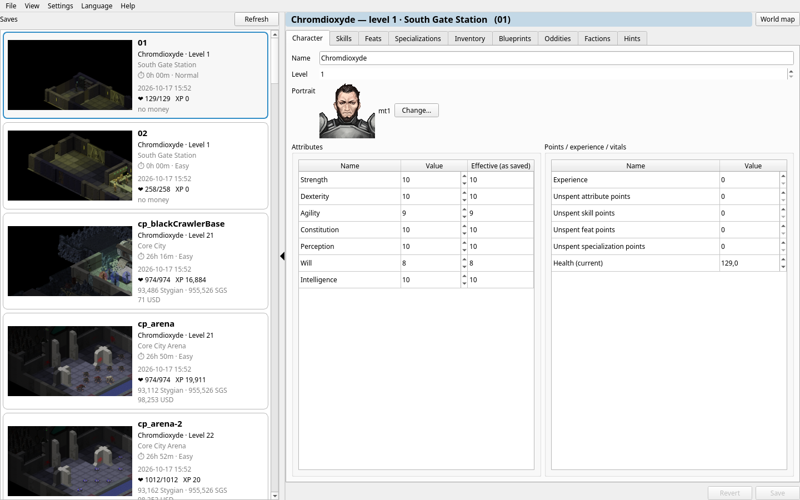

### Feats and specializations

Every feat with its icon, the game's own description and its requirements. Search names and descriptions,
or show only the feats your character can take right now. Specializations work like the character screen
in the game.

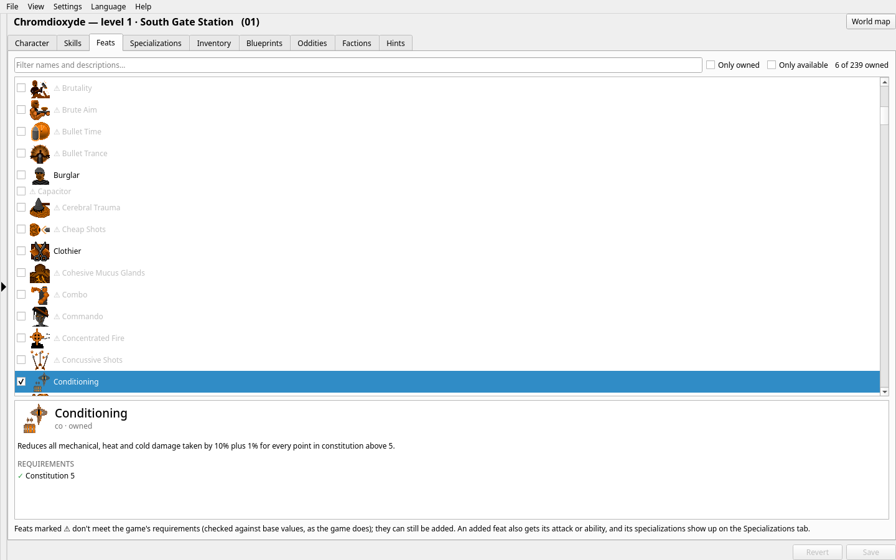

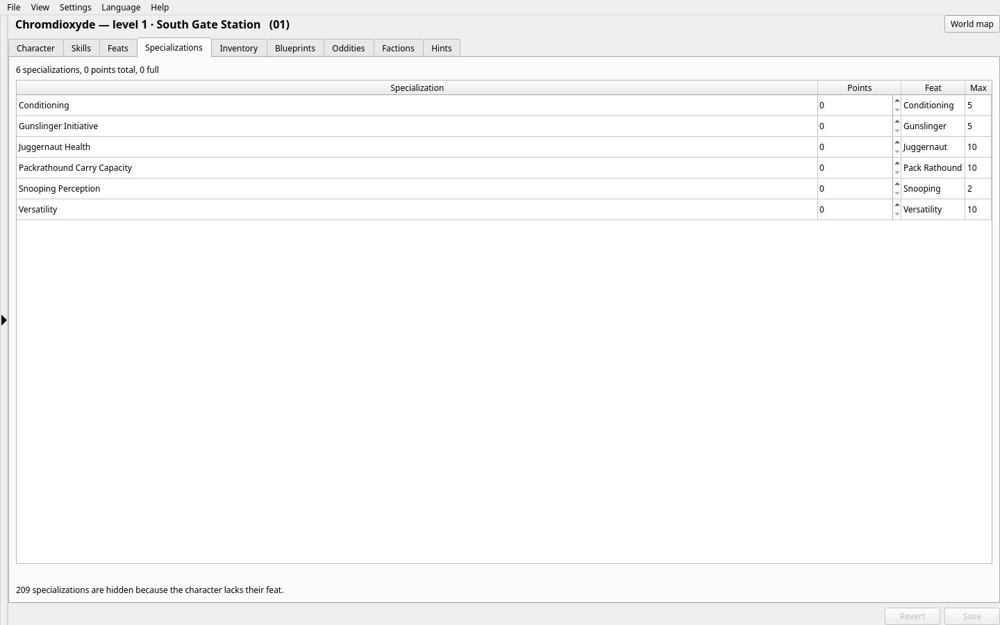

### Inventory

Sort and filter your gear, edit stacks, quality and durability, and select any weapon or armor to see how
it stacks up against what you have equipped. *Add item…* searches all of the game's items by name, type,
rarity or description.

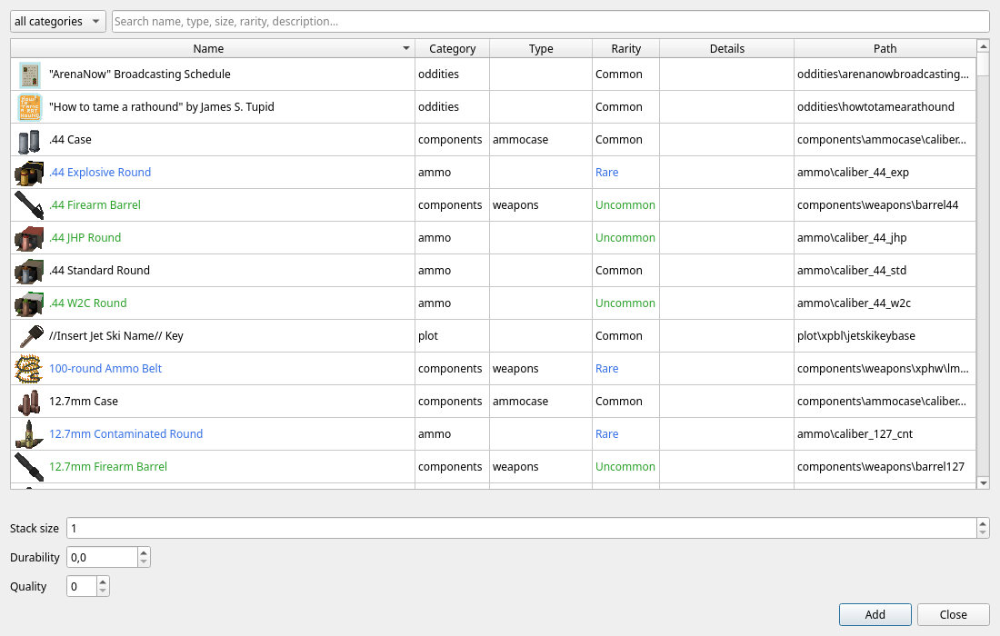

### Blueprints

Learn or forget any crafting blueprint – or all of them.

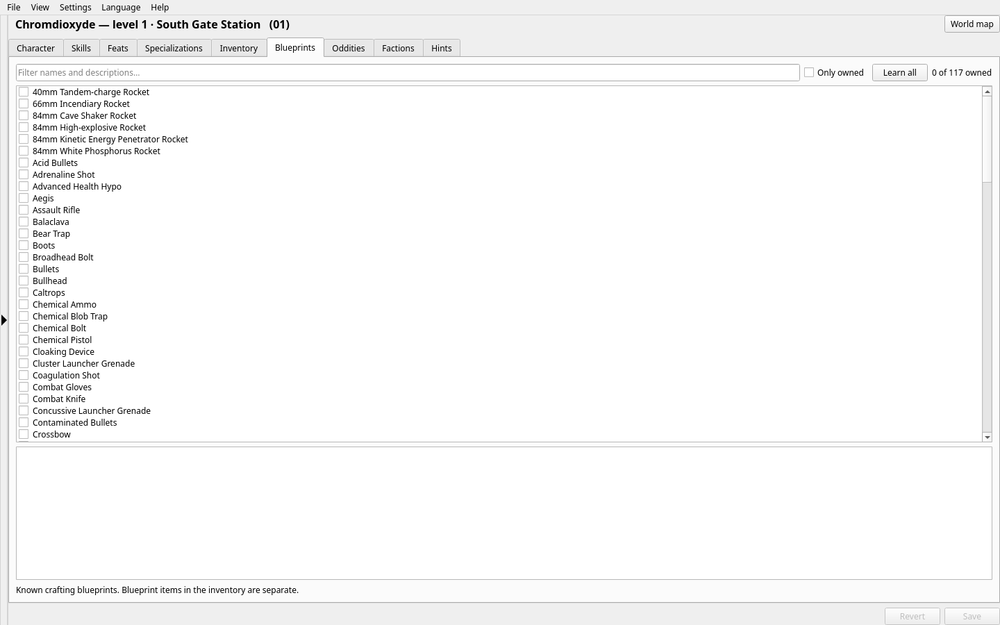

### Factions

The Faceless decide how they treat you from what you did earlier in the game. The editor shows that
verdict as the game calculates it, lets you change what feeds into it, and can skip the mindreading scene
if it hangs.

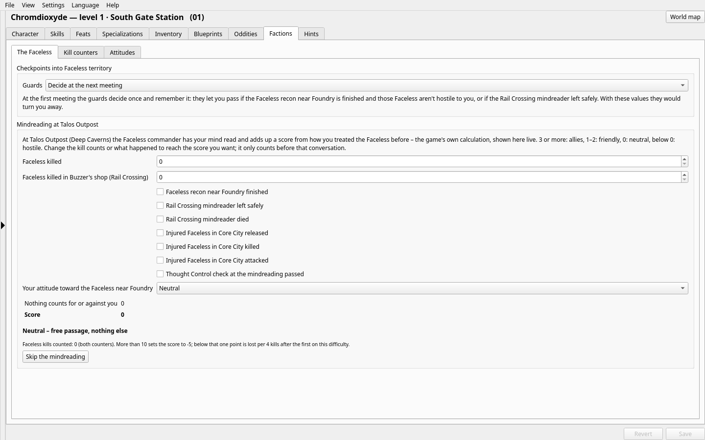

### Build advisor

Choose a build – or let the editor recognise yours – and see its key attributes, skills and feats, every
weapon of its family ranked by damage per action point with your skill, and the best armor combinations
with where to buy or find each part.

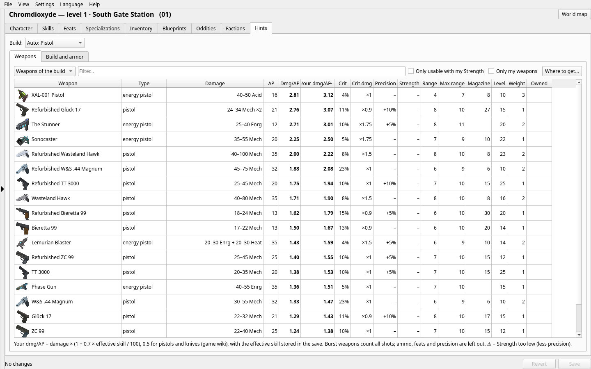

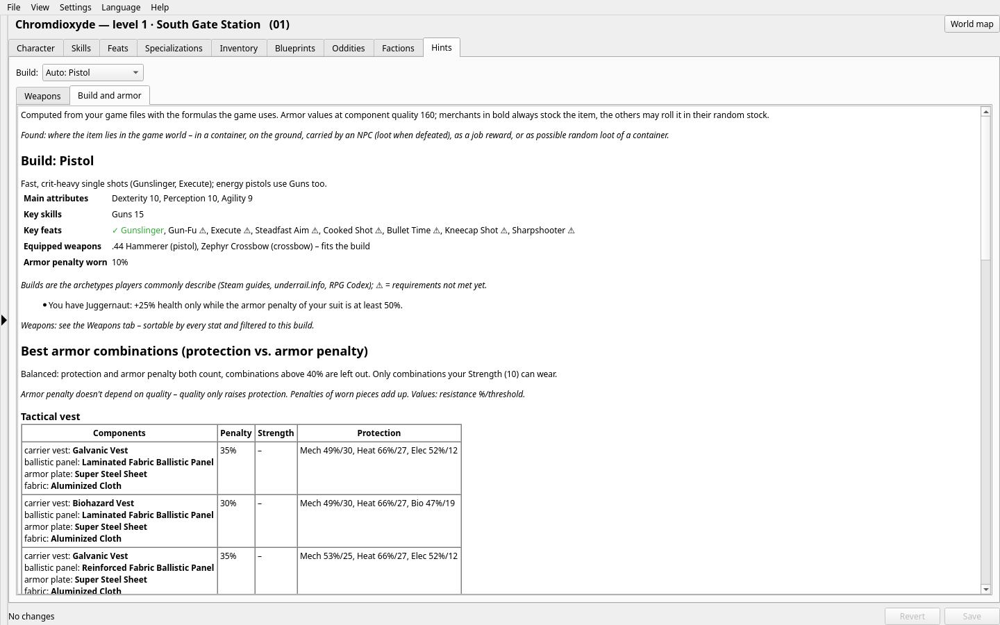

### World map and item finder

The game's own world map, with merchants, creatures and loot for every zone, and your current location
marked. Looking for a specific item? The finder lists every merchant, container and creature that has it
and highlights them on the map.

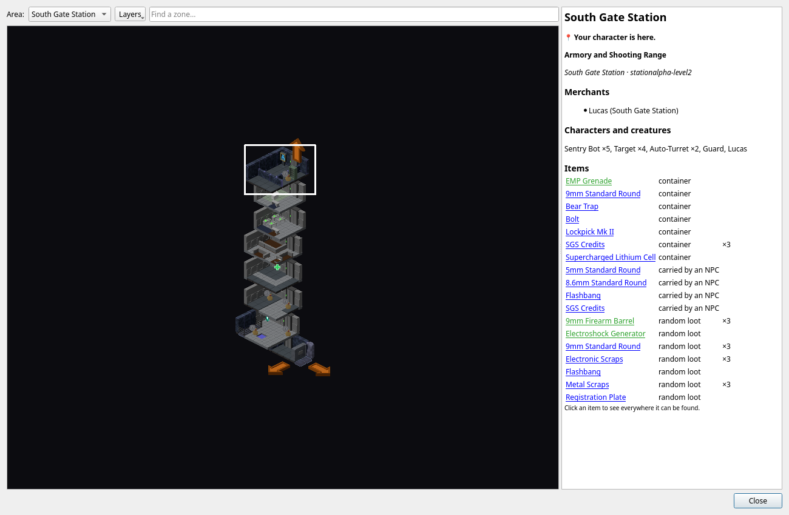

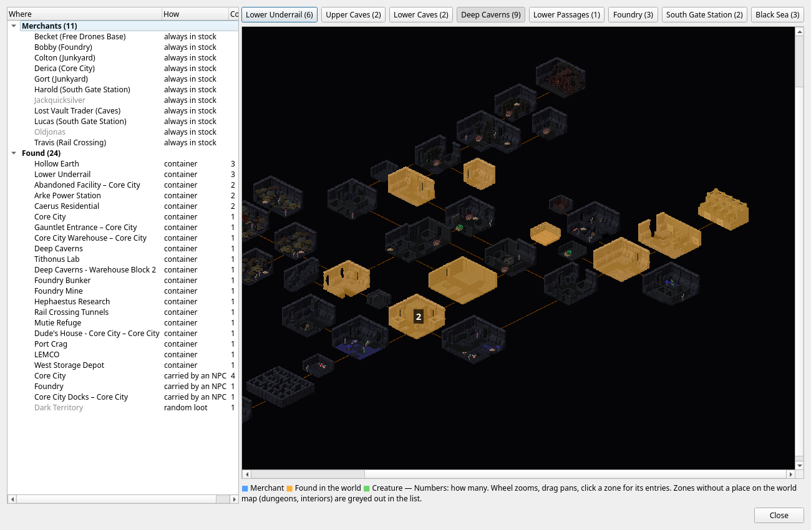

<details>
<summary>More screenshots</summary>

**Skills**
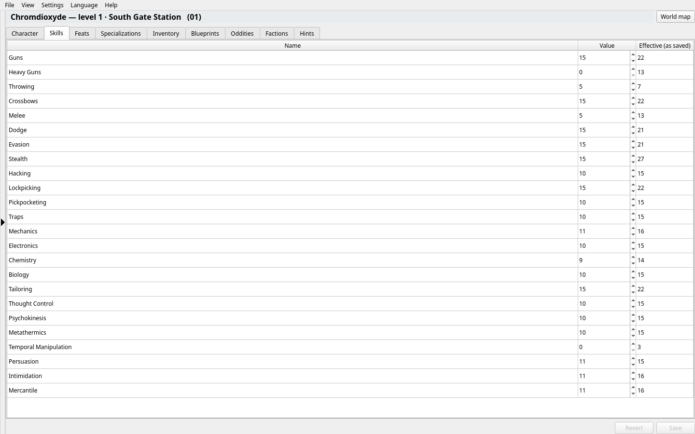

**Oddities**
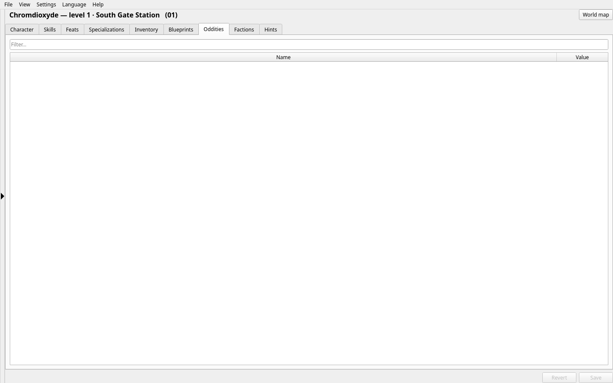

**Factions: kill counters**
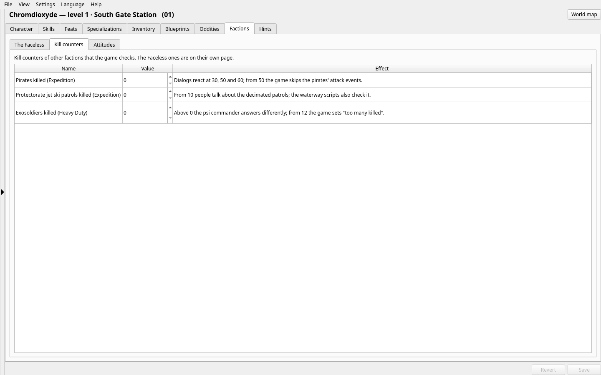

**Factions: attitudes**
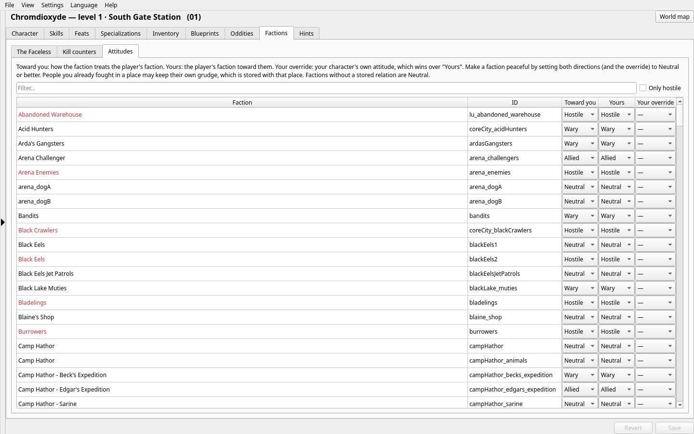

**About**
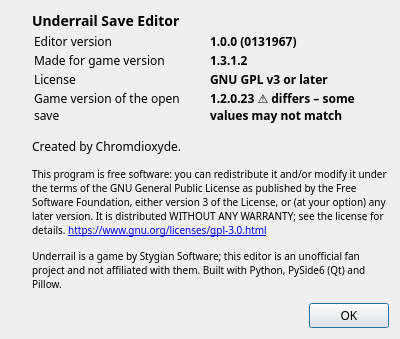
</details>

## Under the hood

Curious how the save format works, where the game data comes from, or how to build the AppImage and the
Windows version? See [docs/TECHNICAL.md](docs/TECHNICAL.md).

## License

Copyright (C) Chromdioxyde. This program is free software: you can redistribute it and/or modify it under
the terms of the GNU General Public License as published by the Free Software Foundation, either version 3
of the License, or (at your option) any later version (GPL-3.0-or-later). It is distributed WITHOUT ANY
WARRANTY; see [LICENSE](LICENSE) for the full text.

The AppImage and the Windows build bundle Python (PSF license), PySide6/Qt (LGPL-3.0) and Pillow (MIT-CMU
license) under their own licenses. Underrail and its data (names and values read from the game's files)
belong to Stygian Software; this is an unofficial fan project, not affiliated with them.
